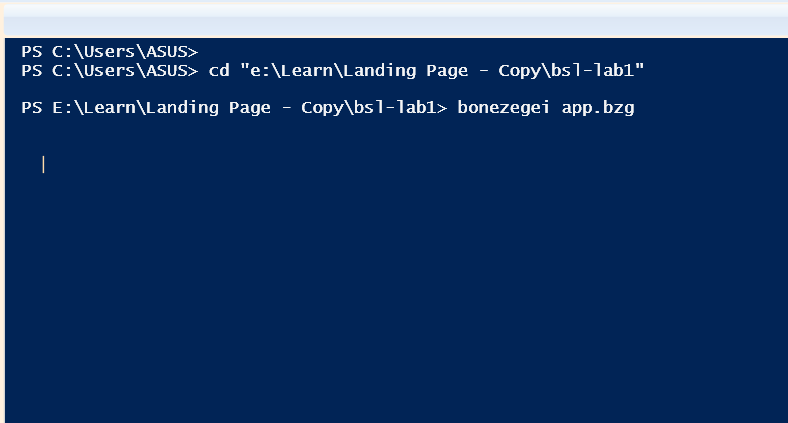
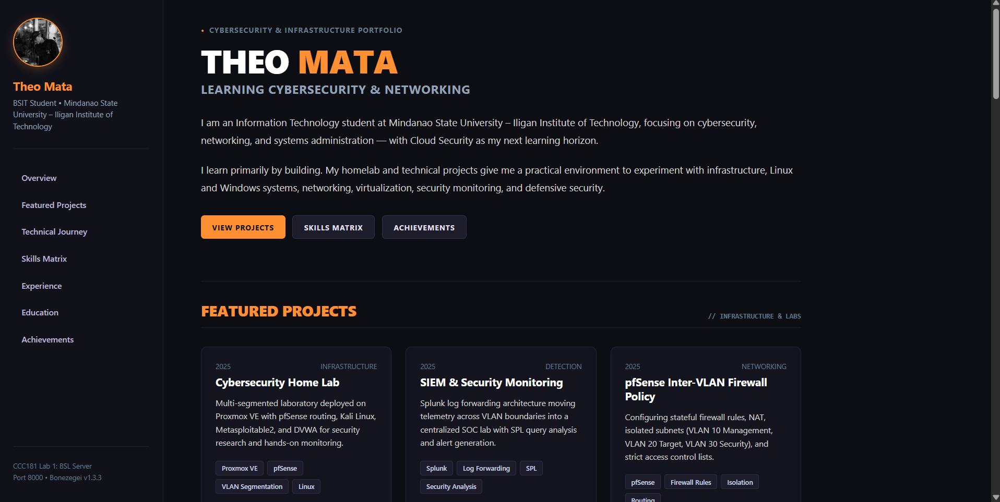

# CCC181: Application Development and Emerging Technologies
## Laboratory 1 — BSL HTTP Web Server Personal Portfolio


---

## 1. Project Title & Overview

**Project Title:** Personal Portfolio Web Application Hosted on Bonezegei Scripting Language (BSL) HTTP Web Server

**Course:** CCC181 &mdash; Application Development and Emerging Technologies  
**Institution:** Mindanao State University &ndash; Iligan Institute of Technology (MSU-IIT)  
**Author:** Theo Mata (BS Information Technology)

### Description
This project delivers a customized static personal portfolio served using the **Bonezegei Scripting Language (BSL) v1.3.3 HTTP Web Server framework**. Adapted from an existing modern portfolio, this lab edition transforms dynamic React components into pure, highly optimized semantic HTML5 and responsive CSS. 

The portfolio showcases real-world academic projects, cybersecurity homelab architecture (Proxmox VE, pfSense, Splunk SIEM), networking credentials (TESDA NC II Computer Systems Servicing), competition awards, and verified technical experience, all delivered through an event-driven lightweight BSL HTTP server.

---

## 2. Technologies Used

- **Runtime & Interpreter:** Bonezegei Scripting Language (BSL) v1.3.3 (`bonezegei.exe`)
- **Package Manager:** `bzg` (`bzg.exe` v1.0.2)
- **Web Server Module:** `BSL_HTTP` framework (`http(8000)`)
- **Frontend / Markup:** Semantic HTML5, CSS3 Custom Properties (Design System), Flexbox, CSS Grid
- **Typography & Assets:** System UI font stack, optimized self-contained base64 visual identity
- **Version Control:** Git & GitHub

---

## 3. Project Structure

The laboratory submission directory adheres strictly to the official framework layout:

```text
CCC181-Lab1-BSL-Portfolio/
├── app.bzg                     # BSL server entry point & HTTP route handlers
├── package.json                # Project manifest and BSL dependencies ("http": "^1.0.0")
├── LICENSE                     # Dual-attributed MIT License (MSU-IIT framework & Theo Mata portfolio)
├── README.md                   # Complete lab documentation and execution guidelines
├── libwinpthread-1.dll         # Required 64-bit runtime dependency for http.dll
├── lib/                        # Downloaded BSL modules (created by bzg install)
│   ├── http.bzg                # HTTP wrapper module
│   ├── http.json               # Module function metadata
│   └── http/                   # Compiled native C library
│       └── http.dll            # Native HTTP/WebSocket shared library
├── public/                     # Static files served by the BSL HTTP server
│   ├── index.html              # Tailored personal portfolio (HTML5/CSS3)
│   └── 404.html                # Custom styled fallback error page
└── screenshots/                # Dedicated folder for laboratory verification evidence
    ├── terminal_execution.png  # Terminal screenshot of 'bzg run' / 'bonezegei app.bzg'
    └── browser_rendered.png    # Browser screenshot of http://localhost:8000
```

---

## 4. Prerequisites

Before running the server, ensure you have the following installed on your machine:

1. **Visual Studio Code** (or compatible code editor)
2. **Bonezegei Scripting Language v1.3.3**:
   - Installed at `C:\Program Files\Bonezegei` (with `bonezegei.exe` and `bzg.exe`).
   - `C:\Program Files\Bonezegei` is configured in your System `PATH`.
   - Verify installation in your terminal:
     ```powershell
     bonezegei --version
     bzg --version
     ```

---

## 5. Installation & Environment Setup

1. Open your PowerShell or Command Prompt terminal and navigate directly into the project directory:
   ```powershell
   cd CCC181-Lab1-BSL-Portfolio
   ```

2. Confirm that the CLI tool is available in your PATH:
   ```powershell
   bonezegei --version
   ```
   *(Expected output: Bonezegei Script Interpreter v1.3.3)*

---

## 6. Dependency Installation

The required `http` server module declared in `package.json` is installed using the BSL package manager:

```powershell
bzg install
```

> **Behavior:** Running `bzg install` reads `package.json` and downloads the official `http` library module directly into the local `lib/` directory (`lib/http.bzg` and `lib/http/http.dll`).

---

## 7. Launching the HTTP Server

Run the BSL server using either of the following methods:

### Method A: Via Command Line (Recommended)
```powershell
bzg run
```
*Alternatively, you can run the interpreter directly:*
```powershell
bonezegei app.bzg
```

### Method B: Via Visual Studio Code Extension
- Open `app.bzg` in VS Code.
- Click the **Run** button provided in the upper-right corner by the Bonezegei extension.

---

## 8. Verified Local Browser URL & Endpoints

Once the server is running, open any web browser and navigate to:

```text
http://localhost:8000
```

- **Home Route (`/` or `/index.html`):** Loads Theo Mata's customized personal portfolio page (`public/index.html`). **[Verified: HTTP 200 OK]**
- **Unregistered Routes (e.g. `/not-found`):** Serves the custom styled `public/404.html` page. **[Verified: HTTP 200 OK]**
- **Server Port:** `8000` (configured in `app.bzg` via `var server = http(8000);`).

---

## 9. Troubleshooting

| Issue / Error | Cause | Resolution |
| :--- | :--- | :--- |
| `Failed to load library: lib/http/http.dll` | Missing 64-bit runtime dependency (`libwinpthread-1.dll`) | Ensure `libwinpthread-1.dll` is present in the project directory. |
| `'bzg' or 'bonezegei' is not recognized` | BSL folder not loaded in current terminal session | Close and re-open PowerShell, or run `C:\Program Files\Bonezegei\bonezegei.exe app.bzg`. |
| `Port 8000 already in use` | Another process is bound to port 8000 | Stop the conflicting process, or update the port number in `app.bzg` (e.g. `http(8080)`). |
| `404 Not Found displayed` | Navigating to sub-routes not mapped in `app.bzg` | The server maps `/` to `public/index.html`. Return to `http://localhost:8000/`. |

---

## 10. Execution Verification Screenshots

### Screenshot 1: Successful Terminal Execution
Execution of `bzg run` / `bonezegei app.bzg` running the HTTP web server on port 8000 without errors:



### Screenshot 2: Rendered Portfolio in Browser
The rendered personal portfolio landing page running in the browser at `http://localhost:8000`:



---

## 11. Official MIT License & Attribution

This project is licensed under the **MIT License**.

- **Underlying BSL HTTP Framework:** Copyright (c) 2026 Mindanao State University - Iligan Institute of Technology.  
  Reference repository: [msuiit-ph/BSL_HTTP_and_WebSocket](https://github.com/msuiit-ph/BSL_HTTP_and_WebSocket)
- **Portfolio Implementation & Content:** Copyright (c) 2026 Theo Mata.

See the full [LICENSE](LICENSE) file for complete terms.
